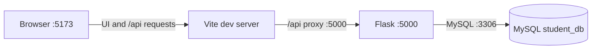
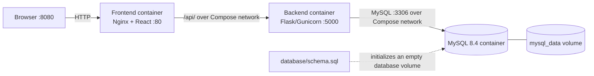
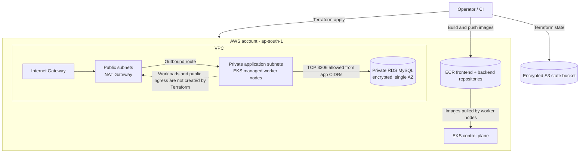

# Student Management Application

A three-tier application with a React/Vite frontend, Flask API, and MySQL database.
This guide covers native local development, Docker Desktop, and AWS infrastructure
provisioning with Terraform.

## Application overview

| Tier | Technology | Role |
| --- | --- | --- |
| Frontend | React, Vite, Nginx | Student management UI; forwards `/api/` requests to Flask |
| Backend | Flask, Gunicorn | Health and student API endpoints |
| Database | MySQL 8.4 locally / MySQL 8.0 on AWS | Stores student records |

## 1. Local development

### Prerequisites

- Python 3.12
- Node.js 22 and npm
- MySQL 8.4, running locally

### Architecture



The Vite development server serves the React app and proxies API requests to the
local Flask server. Flask reads database settings from `backend/.env`.

### Steps (Windows PowerShell)

1. Start MySQL and create the database and application user. From the repository
   root, initialize the schema:

   ```powershell
   Get-Content database\schema.sql | mysql -u root -p
   ```

   In a MySQL shell, create a local application user and grant access. Replace
   the example password with your own:

   ```sql
   CREATE USER 'flaskuser'@'localhost' IDENTIFIED BY 'choose-a-local-password';
   GRANT ALL PRIVILEGES ON student_db.* TO 'flaskuser'@'localhost';
   ```

2. Create the backend environment file:

   ```powershell
   Copy-Item backend\.env.example backend\.env
   ```

   Edit `backend/.env` and set `DB_HOST=localhost`, `DB_PORT=3306`,
   `DB_USER=flaskuser`, `DB_PASSWORD` to the password from step 1,
   `DB_NAME=student_db`, and a unique `SECRET_KEY`. Keep this file local; do not
   commit secrets.

3. Install and start the Flask API:

   ```powershell
   cd backend
   py -3.12 -m venv .venv
   .\.venv\Scripts\Activate.ps1
   python -m pip install -r requirements.txt
   python app.py
   ```

   The API listens on `http://localhost:5000`. Check
   `http://localhost:5000/api/health` for service health.

4. In a second terminal, install and start the React development server:

   ```powershell
   cd frontend
   npm ci
   npm run dev
   ```

5. Open `http://localhost:5173`. Vite forwards `/api/` requests to the API.

## 2. Docker Desktop deployment with Compose

### Prerequisites

- Docker Desktop installed and running, with the Linux container engine enabled
- Docker Compose v2 (`docker compose`)

### Architecture



Compose exposes the frontend on port `8080`. The API and database communicate
over Compose's private default network; only MySQL is additionally bound to
`127.0.0.1:3307` for local database tools. The named volume preserves database
files when containers are recreated.

### Steps

1. In the repository root, copy the Compose environment example:

   ```powershell
   Copy-Item .env.example .env
   ```

2. Edit `.env` and replace all example values with strong, unique secrets:
   `MYSQL_ROOT_PASSWORD`, `DB_PASSWORD`, and `SECRET_KEY`. Do not commit `.env`.

3. Build the images and start all services:

   ```powershell
   docker compose up --build -d
   docker compose ps
   ```

4. Open `http://localhost:8080`. Check API health at
   `http://localhost:8080/api/health`.

5. To inspect logs or stop the services:

   ```powershell
   docker compose logs -f
   docker compose down
   ```

   `docker compose down` keeps the `mysql_data` volume. **To permanently delete
   the local database contents**, use `docker compose down -v`. The schema is
   only run when MySQL initializes a new, empty data directory.

## 3. AWS infrastructure and deployment with Terraform

### What Terraform creates

The Terraform configuration provisions AWS infrastructure in `ap-south-1`:

- A VPC with public, private application, and private database subnets across
  two configured Availability Zones, plus an Internet Gateway and a NAT Gateway.
- ECR repositories for frontend and backend images.
- An EKS cluster and a managed worker node group in the private application
  subnets.
- A private, encrypted, single-AZ RDS MySQL instance in the private database
  subnets, with access limited to the configured private application CIDRs.
- An S3 bucket for remote Terraform state via the separate bootstrap config.

**Important:** Terraform currently provisions infrastructure only. It does not
create Kubernetes Deployments, Services, an Ingress/load balancer, or install an
AWS load-balancer controller. Therefore, applying Terraform alone does not make
the application available on the internet. Those Kubernetes workload and
traffic-routing resources must be configured and deployed separately.

### AWS architecture



The dashed application/ingress path is a reminder that the current Terraform
code does not deploy or expose the frontend and API. The worker nodes can pull
images from ECR; RDS is not publicly accessible.

### Prerequisites

- An AWS account with permissions to create VPC, EKS, IAM, ECR, RDS, and S3
  resources
- AWS CLI configured with credentials (`aws sts get-caller-identity` should
  succeed)
- Terraform 1.10 or later
- Docker Desktop and `kubectl`

### Steps to provision AWS infrastructure

1. **Review AWS settings.** Check `terraform/terraform.tfvars`:
   - Choose a project name, region-compatible Availability Zones, and
     non-overlapping VPC/subnet CIDRs.
   - Set `cluster_endpoint_public_access_cidrs` to your own public IP in `/32`
     notation. The value in the checked-in example is only a placeholder; do
     not leave a broad or untrusted range permitted.
   - `single_nat_gateway = true` reduces development cost but is not
     Availability-Zone resilient.

2. **Create the remote state bucket.** From the repository root:

   ```powershell
   terraform -chdir=terraform\bootstrap init
   terraform -chdir=terraform\bootstrap plan
   terraform -chdir=terraform\bootstrap apply
   terraform -chdir=terraform\bootstrap output -raw terraform_state_bucket
   ```

   Copy the bucket name from the last command. `terraform/backend.tf` contains
   a literal bucket name: make its `bucket` value match the bootstrap output
   before initializing the main configuration. The bootstrap bucket has
   versioning, server-side encryption, public access blocking, and deletion
   protection.

3. **Configure Terraform credentials.** Supply the RDS password as the
   sensitive `db_password` variable without putting it in the tracked
   `terraform/terraform.tfvars`. For PowerShell, enter it at a secure prompt:

   ```powershell
   $secret = Read-Host "RDS password" -AsSecureString
   $env:TF_VAR_db_password = [System.Net.NetworkCredential]::new("", $secret).Password
   ```

   Terraform marks this variable sensitive, but its value is still stored in
   Terraform state. Protect access to the encrypted S3 state bucket and do not
   publish plan or state files. Remove the environment variable when finished:

   ```powershell
   Remove-Item Env:\TF_VAR_db_password
   ```

4. **Initialize the main configuration.** If this configuration already has
   local Terraform state that must be retained, migrate it to S3:

   ```powershell
   terraform -chdir=terraform init -migrate-state
   ```

   If there is no existing local state to migrate, initialize/reconfigure
   against the S3 backend instead:

   ```powershell
   terraform -chdir=terraform init -reconfigure
   ```

5. **Review and apply the planned infrastructure:**

   ```powershell
   terraform -chdir=terraform fmt -check -recursive
   terraform -chdir=terraform validate
   terraform -chdir=terraform plan -out=tfplan
   terraform -chdir=terraform apply tfplan
   ```

   Review the plan and expected AWS costs before applying. EKS, NAT Gateway,
   and RDS incur ongoing charges. The current RDS configuration disables
   deletion protection and skips its final snapshot; destroying it permanently
   deletes the database.

6. **Read the generated resource details and connect `kubectl`:**

   ```powershell
   terraform -chdir=terraform output
   aws eks update-kubeconfig --region ap-south-1 --name student-management-dev
   kubectl get nodes
   ```

   If you changed `project_name` or `environment`, use the resulting
   `eks_cluster_name` Terraform output instead of the example cluster name.

### Building and publishing application images

After Terraform has created ECR, authenticate Docker and push the frontend and
backend images. Run from the repository root in PowerShell:

```powershell
$region = "ap-south-1"
$accountId = aws sts get-caller-identity --query Account --output text
$frontendRepo = terraform -chdir=terraform output -raw frontend_ecr_url
$backendRepo = terraform -chdir=terraform output -raw backend_ecr_url

aws ecr get-login-password --region $region |
  docker login --username AWS --password-stdin "$accountId.dkr.ecr.$region.amazonaws.com"

docker build -t "${frontendRepo}:latest" .\frontend
docker push "${frontendRepo}:latest"
docker build -t "${backendRepo}:latest" .\backend
docker push "${backendRepo}:latest"
```

Pushing images does not deploy them. Complete the application rollout by
creating Kubernetes manifests (or a Helm chart) for the frontend and backend,
configuring the ECR image URLs, and providing the RDS endpoint, database
credentials, and `SECRET_KEY` through Kubernetes Secrets. Also create
appropriate Services and a public ingress/load balancer; the required ingress
controller and Kubernetes manifests are not included in this repository.

The local `database/schema.sql` is automatically mounted by Docker Compose but
is **not** automatically applied to RDS. Initialize the RDS schema using a
controlled MySQL client or one-off job running inside the VPC; do not make RDS
publicly accessible just to run the SQL.

### Cleanup

To destroy the main infrastructure after backing up any data:

```powershell
terraform -chdir=terraform destroy
```

This destroys billable AWS resources and permanently removes the current
development RDS database (no final snapshot is configured). The state bucket
is managed separately and has deletion protection; only remove it after
carefully handling the Terraform state and confirming no state is needed.
